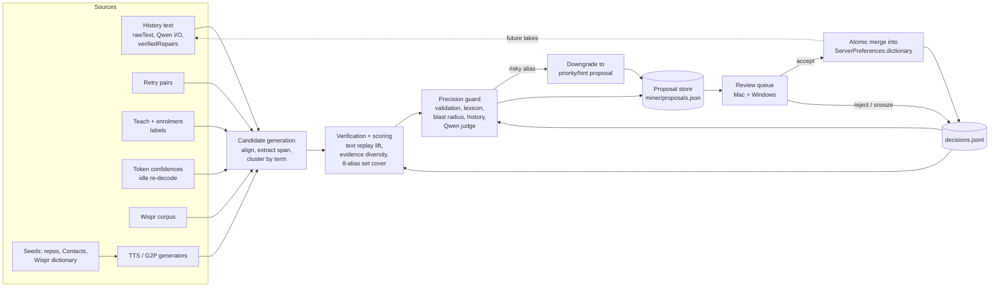
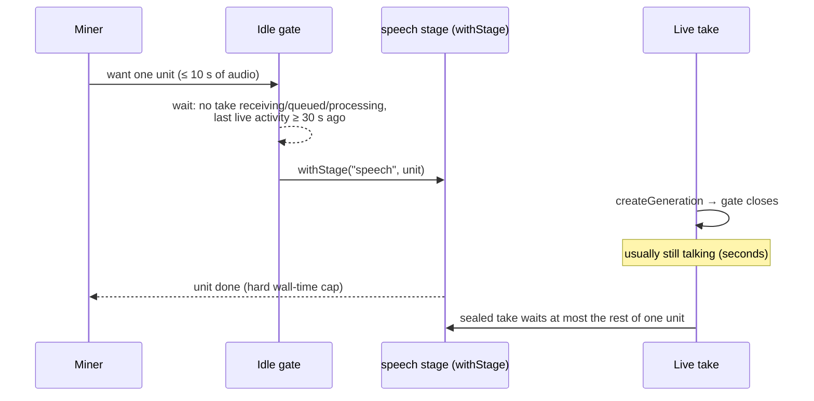

# Dictionary miner (design)

Status: design for discussion. Nothing here is implemented.

Inlay's dictionary only acts after recognition. Parakeet takes no vocabulary prompt (`Server/src/generation-service.ts:1549`; `Engine/worker.cpp:293` reports every term as omitted). The dictionary helps in two ways. Aliases rewrite known mishearings deterministically. Terms, priority ones first, reach Qwen as hints, so Qwen may repair a term with no alias. Only aliases are reliable, and they must match the ways Parakeet actually mishears each term. Today those are added by hand.

The miner is an offline loop. It runs when the server is idle. It mines candidate terms and aliases, verifies and scores them, rejects risky ones, and queues proposals for review. It never edits the dictionary on its own.

Claims marked **(unverified)** depend on behaviour the code does not show. Measure them before building on them.

## Facts the design depends on

| Fact                                                                                                                                                                             | Where                                                                   |
| -------------------------------------------------------------------------------------------------------------------------------------------------------------------------------- | ----------------------------------------------------------------------- |
| Pipeline: Parakeet → `cleanTranscript` → `applyDictionary` → list formatting → Qwen → `applyDictionary` → `evaluateCorrection`.                                                  | `generation-service.ts:1533-1630`                                       |
| `rawText` (Parakeet), `textProcessing.inputText/proposedText/outputText`, `verifiedRepairs` and rejection reasons are stored per take.                                           | `metadata.json`, `generation-service.ts:1559`, `:1715-1726`             |
| Dictionary: at most 500 entries, 32 lists, 8 aliases per entry. Each spelling maps to one term across all lists.                                                                 | `Server/src/domain/dictionary.ts:3`, `:56`, `:96-107`                   |
| Qwen gets at most 80 terms or 4 KB of hints, priority terms first. With 500 terms, about 420 never reach Qwen.                                                                   | `Server/src/domain/correction.ts:109`                                   |
| The validator accepts Qwen joining 2–3 fragments into a hinted term within edit distance 1 (e.g. `mini max` → `MiniMax`).                                                        | `correction.ts:649` (`recognizedTerms`)                                 |
| Speech and proof each run one job at a time through promise-chain FIFOs (`withStage`). There is no priority.                                                                     | `generation-service.ts:279`                                             |
| `InferenceBackend.cancel()` resets any active or loading helper; only idle warm helpers survive. Cancelling a background job would force a model reload.                         | `Server/src/inference/native-inference.ts:424`, `helper-process.ts:174` |
| Both decoders are greedy (Parakeet `PARAKEET_SAMPLING_GREEDY`, Qwen `llama_sampler_init_greedy`), with `no_context`.                                                             | `Engine/worker.cpp`, `TextEngine/worker.cpp:173`                        |
| parakeet.cpp exposes per-token `p`, `plog`, `t0`, `t1`, `is_word_start` and `parakeet_tokenize`. The helper discards them today.                                                 | `vendor/whisper.cpp/include/parakeet.h:53-67`, `:153`, `:327-332`       |
| Retention purges `inference.wav` after `audioRetentionDays` (default 90). The audio corpus is a rolling window. `docs/architecture.md` says audio is always kept; that is stale. | `generation-service.ts:1276`                                            |
| Wispr Flow imports keep the WAV, `source.json` (with `asrText`, `formattedText`, `pastedText` and edits when present) and Wispr's dictionary.                                    | `docs/wispr-flow-import-plan.md`, `Server/src/imports.ts:856`           |
| Swift bindings are generated from `Server/api/openapi.yaml`. The Windows client's `Windows/src/api.rs` is written by hand.                                                       | `bun run generate:api`, `api.rs:1`                                      |
| `generation_processed` logs already carry `queueWaitMs`, `transcribeMs` and `proofMs`.                                                                                           | `generation-service.ts:1633`                                            |

One consequence shapes the whole design. Both decoders are greedy and stateless, so re-running a stored `inference.wav` should reproduce the stored `rawText` **(unverified: thread count and float ordering could change bytes)**. Testing a candidate alias against real takes is then a **text replay** of `rawText` through `cleanTranscript` → `applyDictionary`. It costs microseconds, not a Parakeet call. Audio re-runs are only worth it to learn something new: token confidences, perturbed variants, or a changed model.

## Ideas, ranked

Value is expected precision × volume of good aliases. Effort counts code across server, helper and both clients. **S** = days, **M** = a week or two, **L** = more.

| #   | Idea                                                                                                                                                                                                                                                                                                                      | Value | Effort | Notes                                                                                                                                        |
| --- | ------------------------------------------------------------------------------------------------------------------------------------------------------------------------------------------------------------------------------------------------------------------------------------------------------------------------- | ----- | ------ | -------------------------------------------------------------------------------------------------------------------------------------------- |
| 1   | **Qwen-fix harvest.** Word-align `inputText` against accepted `outputText`. Spans that Qwen turned into a dictionary term become `(term, alias = input span)`. Making them aliases makes the fix deterministic. It then survives Qwen rejections, the 80-term hint budget and proofreading being off.                     | H     | S      | Text only. Needs evidence from at least 2 takes so one Qwen hallucination can't become an alias.                                             |
| 2   | **Blast-radius replay (guard).** Apply the candidate alias to every stored `rawText`. Count the takes it would rewrite that have no other link to the term. Show them in review.                                                                                                                                          | H     | S      | Text only. The strongest precision guard, because it uses my actual speech.                                                                  |
| 3   | **Common-word risk score.** Flag aliases built from common English words. Use a small bundled frequency list, plus Parakeet's own BPE vocabulary: a word that is a single `▁word` piece is common in its training data.                                                                                                   | H     | S      | The tokenizer signal needs a `tokenize` helper request. List licence is an open question.                                                    |
| 4   | **Teach from History.** Select words in a take, pick or type the right term. This is an explicit label, and it becomes accepted evidence.                                                                                                                                                                                 | H     | M      | Needs UI on both clients. The highest-precision signal there is.                                                                             |
| 5   | **Pronunciation enrolment.** A review card offers "Say it three times". It uses the existing test-mode take, so the audio is my voice saying the term.                                                                                                                                                                    | H     | M      | Turns a cold-start term into real evidence in about 10 s.                                                                                    |
| 6   | **Token-confidence spans.** The helper emits per-token `p`/`t0`/`t1` on request. Low-confidence spans that recur across takes show where Parakeet struggles.                                                                                                                                                              | H     | M      | C++ change in `Engine/worker.cpp` only; the vendored code stays intact. Calibration of `p` is **unverified**.                                |
| 7   | **Retry pairs.** The same device makes two takes within about 20 s whose texts mostly match but differ in one span. That usually means "it got it wrong, I said it again".                                                                                                                                                | M     | S      | Server-only and free. Weak alone; good corroboration.                                                                                        |
| 8   | **Dictionary hygiene.** Propose removing aliases that never fired in N days and terms never seen. Re-rank priority so the 80 hint slots go to terms that depend on Qwen (used often, poorly covered by aliases).                                                                                                          | M     | S      | Text replay gives fire counts without touching the hot path. Frees slots under the cap.                                                      |
| 9   | **Odd recurring tokens.** Tokens in `rawText` that are not in the lexicon, recur in at least 3 takes on at least 2 days, and are not already a term or alias. Cluster them by edit and phonetic distance to existing terms: close ones become alias proposals, the rest new-term proposals.                               | M     | S      | Cheap. Noisy without the guard.                                                                                                              |
| 10  | **Wispr Flow corpus.** For imported takes with audio, run Parakeet and align its output against Wispr's `pastedText`. Wispr's dictionary seeds terms.                                                                                                                                                                     | H\*   | M      | \*Only if there is a real volume of imports with audio. Each import is an independently labelled pair in my voice.                           |
| 11  | **Perturbation replays.** Re-run retained audio around a known term span at 0.9×/1.1× speed, ±6 dB and shifted crops. Variant outputs at that span are more aliases in my voice.                                                                                                                                          | M     | M      | Uses idle Parakeet time. Diminishing returns past a few variants **(unverified)**.                                                           |
| 12  | **Seed harvest from typed text.** A CLI scans paths I choose (repo names, `package.json`/`Cargo.toml` dependencies, identifiers split on camelCase, git authors) and ranks them by frequency × OOV score. Optionally Mac Contacts names.                                                                                  | M     | M      | Yields terms, not aliases. Feeds 5, 13 and 14. Runs where the text lives, so the server never reads my files.                                |
| 13  | **Phonetic neighbours.** G2P the term with [espeak-ng](https://github.com/espeak-ng/espeak-ng), then search for English word sequences with close phoneme strings (`kubectl` → `cube cuddle`). No audio needed.                                                                                                           | M     | M      | Generates candidates only. They must be confirmed by 1, 6, 11 or 14.                                                                         |
| 14  | **TTS loop.** Synthesise each seed term in many voices and carrier sentences, run Parakeet, harvest the mishearings and score by recovery rate. Choose up to 8 aliases by greedy set cover. Candidate engines: [Piper](https://github.com/OHF-Voice/piper1-gpl), [Kokoro-82M](https://huggingface.co/hexgrad/Kokoro-82M). | M     | L      | Main value is cold start. TTS voices often say OOV terms differently from me **(unverified)**, so recovery rate measures TTS, not my speech. |
| 15  | **Negative TTS probes (guard).** Synthesise sentences that use the alias in its ordinary sense ("the code x-rays…") and count false rewrites.                                                                                                                                                                             | M     | M      | Comes free once 14 exists.                                                                                                                   |
| 16  | **Post-insertion edit capture.** After a confirmed insertion, the Mac (AX value of the focused element) or Windows (UIA TextPattern) re-reads only the inserted range ± a few words after about 30 s. It diffs on the client and sends only substitution pairs.                                                           | H     | L      | Privacy and coverage cost: see [below](#post-insertion-edits). Coverage across apps is **(unverified)**.                                     |
| 17  | **Qwen judge (guard).** In idle time, ask Qwen whether each blast-radius hit "refers to T" in context.                                                                                                                                                                                                                    | M     | S      | Soft score only. Uses the proof helper when idle.                                                                                            |
| 18  | **Qwen brainstorm.** Ask Qwen how a recognizer might mishear T.                                                                                                                                                                                                                                                           | L     | S      | Noisy. Only useful as input to verification.                                                                                                 |
| 19  | **Voice-cloned TTS.** Zero-shot TTS conditioned on my retained audio says seed terms "in my voice".                                                                                                                                                                                                                       | M     | L      | Wacky. Heavy on WSL CPU. Beats 14 only if cloning keeps my accent **(unverified)**.                                                          |
| 20  | **Acoustic clustering.** Embed low-confidence spans (MFCC + DTW, or encoder features) across takes. One cluster with many spellings (`queen`, `Gwen`, `Kwen`) is one term with many aliases.                                                                                                                              | M     | L      | Wacky. Finds terms nobody seeded.                                                                                                            |
| 21  | **Undo detection.** The client sees ⌘Z / Ctrl+Z within seconds of an insertion.                                                                                                                                                                                                                                           | L     | M      | A weak negative label. Mostly useful for metrics.                                                                                            |
| 22  | **Real decoder biasing.** Shallow fusion or word boosting in the TDT decoder would give Parakeet an actual vocabulary prompt.                                                                                                                                                                                             | H     | XL     | Needs changes to vendored parakeet.cpp, which this repo must leave intact. Out of scope; it belongs upstream.                                |

The first three are text-only, run on data the server already has, and need no inference. They are the core. Ideas 4–6 add my voice. Everything from 10 down is cold start or polish.

## Architecture

### Where it runs

**Choice: a `DictionaryMiner` module inside `inlay-server`, plus a read-only CLI entry over the same module.**

- **In-server** is the only placement that can share the warm helpers and see live takes arrive. A separate worker process would load a second Parakeet (and Qwen) into WSL RAM and compete for the same cores with no view of the live queue. It also can't own the data directory, which is `flock`-ed by the running server (`Server/src/data-lock.ts`).
- Text mining runs in a Bun `Worker`, as correction alignment already does (`correction-runtime.ts`), so the HTTP event loop stays responsive.
- The **CLI** (`inlay-server mine --data-dir <snapshot> --report out.md`) runs the text-only stages on a **copy** of a data directory and writes a report. It is Phase 0, and it is also the entry point the out-of-repo eval rig drives. It never writes to the archive it reads and never runs against a live server's directory.

### Pipeline



### Stages

**1. Candidate generation.** Each source emits `Candidate { term, alias?, kind, evidence }`.

- Mine `cleanTranscript(rawText)`, **before** the dictionary is applied. Mining `finalText` would count an accepted alias's own output as fresh evidence for that alias, so the miner would keep confirming itself.
- Qwen's stored `inputText` and `outputText` are both downstream of `applyDictionary` (`generation-service.ts:1570`, `:1714`). The raw Qwen output isn't stored. So a Qwen fix counts as evidence only if two things hold: the term is absent from cleaned `rawText`, and applying that take's frozen dictionary snapshot to the cleaned text doesn't already produce it. The alias is the span of cleaned `rawText` that aligns opposite the term.
- Imported Wispr records store Wispr's recognition as `rawText` (`imports.ts:812`), not Parakeet's. Leave them out of the native corpus, replay, blast radius and fire counts. Use them only through idea 10, where Parakeet re-decodes the audio and its output is stored separately.
- Span extraction is a word-level alignment (Levenshtein over tokens) between the "heard" text and the "meant" text. The meant text is Qwen's accepted output, a teach label, the TTS script or Wispr's `pastedText`. The span opposite the term is the alias.
- Group candidates by `dictionaryKey(term)`. Fold case, because preferred spellings already fix case and an alias that differs only by case is invalid.

**2. Verification and scoring.**

- **Text replay lift:** run the baseline and merged dictionaries over every native take's cleaned `rawText`, using the live 24 KiB output limit. Count takes that newly contain T where some evidence says T was meant: a Qwen fix, a label, or a retry. This replays only the **first** dictionary pass. It shows what Qwen would receive, not the final output, because the second pass runs on Qwen output that the miner doesn't re-run.
- **Evidence diversity:** count distinct takes, distinct days and distinct source kinds. One take seen three ways is still one take.
- **Voice weight:** evidence in my voice (history, enrolment, Wispr) outweighs synthetic evidence (TTS, G2P). A TTS-only proposal is capped at the "low" confidence band.
- **Alias selection:** at most 8 aliases per entry, minus those already present. Choose by greedy set cover over the evidence each alias recovers. When an entry is full, a strong new alias is proposed as a replacement for its lowest-firing one.
- **Score:** a weighted sum of these features, with weights in miner config. Proposals store the **raw features**, not just the score, so weights can be refitted from decisions later.

**3. Precision guard.** Checks run in order. Each failure carries a reason code shown in review.

| Guard                   | Rule                                                                                                                                                                                                                                                                                                |
| ----------------------- | --------------------------------------------------------------------------------------------------------------------------------------------------------------------------------------------------------------------------------------------------------------------------------------------------- |
| G1 `invalid`            | `dictionaryValidationError` on the merged dictionary. Catches alias collisions with another term, the 8-alias limit, length and control characters. Exception: an `addTerm` blocked only by the 500-entry cap stays queued as `needsSlot`, and G1 runs on the full removal-plus-addition at accept. |
| G2 `commonWord`         | A single-word alias that is a common word is rejected outright (`off → auth`). A multi-word alias made only of common words (`code x`) must pass G3 with zero unexplained hits.                                                                                                                     |
| G3 `blastRadius`        | Replay the alias over all stored `rawText`. Hits not explained by evidence are would-be false rewrites. Reject above a threshold (start at 0 for all-common aliases, 1 per 500 takes otherwise). Review shows up to 5 hits.                                                                         |
| G4 `previouslyRejected` | `decisions.jsonl` suppresses the same `(term, alias)` pair, case-folded, until a new evidence kind appears, such as a teach label after a TTS-only rejection.                                                                                                                                       |
| G5 `judge` (soft)       | The Qwen judge (idea 17) and negative TTS probes (idea 15) lower the score. They never pass something G2–G3 rejected.                                                                                                                                                                               |

**Downgrade instead of drop.** When a real term fails G2 or G3 on an alias, the miner proposes the term as **priority** with no alias. That puts it inside Qwen's 80-term hint budget, so Qwen can fix it where the sentence suggests it. This is a limited fallback. The validator doesn't check meaning: its split-name path (`recognizedTerms`) only joins 2–3 fragments within edit distance 1. A distant mishearing like `cube cuddle` → `kubectl` gets a hint, not a guaranteed fix.

**4. Proposal.** Proposal kinds: `addTerm`, `addAliases`, `replaceAlias`, `setPriority`, `removeAlias`, `removeTerm`. Proposals refresh in place as evidence grows and never duplicate. At most 10 new proposals per day reach the queue, highest score first, so review stays small.

**5. Review and apply.** Covered under [Review UX](#review-ux). The server applies changes; clients never rewrite the dictionary themselves.

**6. Feedback.** Every decision is appended to `decisions.jsonl` with the proposal's features at decision time. That log feeds G4, the score weights, and the metrics. After an accept, the miner keeps counting how often the alias fires on new takes. If I remove an accepted alias by hand within 30 days, that is logged as **regret**, a negative label.

### Scheduling: yield to live takes

The live path keeps its plain FIFO stages. The miner adds an **idle gate** in front of them:



- **Pause on `createGeneration`, not on seal.** A take starts when recording starts, so a running miner unit usually finishes while I'm still talking. It isn't guaranteed. Recordings can be as short as 0.25 s (`generation-service.ts:931`), and closing the gate doesn't preempt a unit already in the FIFO. The miner schedules no new units while any take is `receiving`, `queued`, `transcribing` or `proofreading`.
- **Bounded units.** Each Parakeet unit is a crop of at most 10 s around a span, and has a hard wall-time budget (start at 1.5 s). Crops are sized from measured `transcribeMs`, so a unit that would exceed the budget is split or skipped. The worst-case live delay is the remainder of one unit **(unverified: measure `transcribeMs` for crops on the WSL CPU)**, and the live-impact metric tracks it. The miner never cancels a helper, because cancelling resets any active or loading helper and forces a model reload.
- **Crops go through the existing WAV path.** The miner writes a temporary 16 kHz WAV under `miner/scratch/` and calls `inference.transcribe` like a live take. No new helper protocol is needed for Phase 3, apart from optional token detail.
- **Budget.** A daily CPU-seconds cap and a run window (default: overnight, 01:00–07:00 local). Heavy jobs on WSL starve the daily Parakeet instance, so the default is to run when I'm asleep.
- **Text stages** run in the miner `Worker` at any idle time. They are cheap but still yield to the gate.
- **Cursor.** `miner/state.json` records the last mined generation, the miner version and the engine/model hashes. A model change invalidates audio-derived evidence and queues re-verification.

### Data model

Stored under the data directory, next to `generations/`:

```text
miner/
  state.json        cursor, versions, budget counters, last run summary
  proposals.json    pending + recently decided proposals (bounded, ≤ 1 MiB)
  decisions.jsonl   append-only decision log (rotated at 4 MiB)
  scratch/          temporary crops and TTS clips, wiped at each run start
```

```ts
interface DictionaryProposal {
  id: string;
  kind: "addTerm" | "addAliases" | "replaceAlias" | "setPriority" | "removeAlias" | "removeTerm";
  status: "pending" | "needsSlot" | "accepted" | "rejected" | "snoozed" | "stale";
  term: string;
  entryID?: string; // existing entry, when there is one
  aliases: string[]; // proposed additions (or the alias to remove)
  replaces?: string; // replaceAlias only
  isPriority?: boolean;
  confidence: "high" | "medium" | "low";
  features: {
    lift: number; // takes newly recovered by text replay
    distinctTakes: number;
    distinctDays: number;
    sourceKinds: EvidenceSource[];
    voiceEvidence: number; // evidence in my voice vs synthetic
    blastRadius: number; // unexplained would-be rewrites
    commonWordRisk: number; // 0–1
    ttsRecovery?: { before: number; after: number; samples: number };
  };
  guard?: { downgradedFrom: "addAliases"; reason: "commonWord" | "blastRadius" };
  evidence: Evidence[]; // at most 8, most diverse first
  blastSamples: { generationID: string; snippet: string }[]; // at most 5
  basis: {
    dictionaryRevision: number;
    minerVersion: string;
    speechModelSHA256?: string;
    target?: { term: string; aliases: string[]; listID: string; isPriority: boolean }; // entry as proposed against
  };
  createdAt: string;
  updatedAt: string;
}

type EvidenceSource =
  | "qwenFix"
  | "retryPair"
  | "teach"
  | "enrolment"
  | "lowConfidence"
  | "perturbation"
  | "wispr"
  | "tts"
  | "phonetic"
  | "oddToken";

interface Evidence {
  source: EvidenceSource;
  generationID?: string; // absent for synthetic
  span?: { startMs: number; endMs: number }; // for clip playback
  heard: string; // what Parakeet produced
  snippet: string; // ≤ 120 chars around the span
  observedAt: string;
}

interface DictionaryDecision {
  proposalID: string;
  decision: "accept" | "reject" | "snooze" | "regret";
  reason?: "wrongTerm" | "commonWord" | "notMine" | "duplicate" | "later";
  kind: DictionaryProposal["kind"];
  termKey: string; // dictionaryKey(term), so suppression survives proposal-store eviction
  acceptedAliasKeys: string[];
  rejectedAliasKeys: string[]; // unticked chips, or all on reject
  applied?: { term: string; aliases: string[]; isPriority: boolean; listID: string };
  features: DictionaryProposal["features"]; // snapshot at decision time
  decidedAt: string;
  deviceID: string;
}
```

**Privacy.** Evidence copies short transcript snippets, so deleting a generation must also remove its evidence. Proposals left with no evidence become `stale`. A retention purge keeps snippets but drops spans, and the clip then shows as unavailable. Snippets never appear in logs.

### API changes

Add to `Server/api/openapi.yaml`, then regenerate Swift and hand-port to `Windows/src/api.rs`:

| Route                                                  | Purpose                                                                                                                                                                                                                                                                                                                                                                                                                                                                                                                                         |
| ------------------------------------------------------ | ----------------------------------------------------------------------------------------------------------------------------------------------------------------------------------------------------------------------------------------------------------------------------------------------------------------------------------------------------------------------------------------------------------------------------------------------------------------------------------------------------------------------------------------------- |
| `GET /v1/dictionary/proposals?status=pending&cursor=`  | Paged queue.                                                                                                                                                                                                                                                                                                                                                                                                                                                                                                                                    |
| `POST /v1/dictionary/proposals/{id}/accept`            | Body: chosen `aliases` subset, `listID`, `isPriority`, and a `removeEntryID` when at the cap. Also the proposal `updatedAt` the client reviewed. Inside the preferences mutation queue, the server applies only if the proposal is still `pending` at that version, re-runs G1 on the **current** dictionary, then marks it `accepted` and bumps the revision in the same step. Returns the new `PreferencesSnapshot`. A retry of an already-accepted proposal returns the current snapshot without re-applying. A changed version returns 409. |
| `POST /v1/dictionary/proposals/{id}/reject`            | Body: `reason`.                                                                                                                                                                                                                                                                                                                                                                                                                                                                                                                                 |
| `POST /v1/dictionary/proposals/{id}/snooze`            | Hides the proposal for 14 days.                                                                                                                                                                                                                                                                                                                                                                                                                                                                                                                 |
| `GET /v1/dictionary/proposals/{id}/evidence/{n}/audio` | A cropped WAV of one span from `inference.wav` (Phase 3). The same auth and browser-origin rules as `downloadArtifact`.                                                                                                                                                                                                                                                                                                                                                                                                                         |
| `POST /v1/dictionary/teach`                            | `{ generationID, heard, term }` from History (Phase 3).                                                                                                                                                                                                                                                                                                                                                                                                                                                                                         |
| `GET /v1/dictionary/miner`                             | Status: enabled, last run, pending count, budget used, metrics summary.                                                                                                                                                                                                                                                                                                                                                                                                                                                                         |

Add `dictionarySuggestions: boolean` (default `false`) to `ServerPreferences`, so it is shared and revisioned like other settings. Heavy sources (TTS helper path, run window, CPU budget) are server arguments, like the other helper paths.

Acceptance goes through the server so two clients can't race. Serializing writes isn't enough, though: an entry could be renamed or edited after the proposal was made. Inside the mutation queue, the server compares the target entry with the proposal's `basis`. If the entry's term, aliases or list changed, or the dictionary revision moved and the change touches this term, the proposal goes `stale` and is re-scored before it can be accepted. An `addTerm` has no prior entry, so the server also looks up `dictionaryKey(term)` in the current dictionary. G1 allows two entries with the same preferred term (`dictionary.ts:97-105`), so if the term now exists, the proposal is rebased to `addAliases` on that entry and goes back to review rather than adding a duplicate. Editing the dictionary by hand still uses `updatePreferences` and its revision check.

### Review UX

**Default: a human approval queue. No auto-apply.** One bad alias silently rewrites real speech in every future take, and I might not notice for weeks. Review costs seconds per proposal. Auto-apply could be earned later for one narrow class: high confidence, zero blast radius, no common words, at least 2 kinds of voice evidence. It would need measured precision of at least 98% over 50 or more decisions, and it would come with a 7-day undo list. That is an open question, not a plan.

**Mac** (`Sources/Inlay/Views/PreferencesPage.swift`, a **Suggestions** group above the Dictionary editor, with a count badge in the menu):

```text
┌ Suggestions (3) ─────────────────────────────────────────────┐
│ Qwen                                     high · 6 takes · 4 d │
│ Add corrections:  [✓ queen] [✓ gwen] [  kwen]                 │
│ Heard: "ask queen to clean it up" · 2 Nov  ▶                  │
│ Would also change 0 other takes                               │
│ List: [Personal ▾]   ☐ Priority                               │
│                       [Reject ▾]  [Later]  [Accept]           │
├───────────────────────────────────────────────────────────────┤
│ kubectl → priority only (not added as a correction)           │
│ "cube cuddle" would change 2 other takes  ⌄                   │
└───────────────────────────────────────────────────────────────┘
```

- Alias chips accept a subset. Unticked aliases are logged as rejected for that pair.
- ▶ plays the evidence clip (Phase 3). Hearing my own voice settles most cases in a second.
- **The 500-entry cap.** From 480 entries, a banner appears and the miner raises hygiene proposals first. An `addTerm` at the cap waits as `needsSlot` and cannot be accepted until I pick an entry to remove; the removal picker lists the miner's dead-entry suggestions first. Aliases don't count toward the cap. Full entries get `replaceAlias` instead.
- **Priority.** The priority toggle shows how many of the 80 hint slots are in use. The miner proposes priority for frequent terms that rely on Qwen, and proposes dropping it for terms that aliases fully cover.

**Windows** (`Windows/src/settings/server.rs`) gets the same list, in the Win32 control style the dictionary editor already uses. It ships one phase after the Mac. Both clients fetch proposals on open and after each decision; no push channel is needed.

### Metrics

The miner is meant to be hill-climbed, so it records:

| Metric           | Definition                                                                                                                                                                                                                                                                                                                                                                                   |
| ---------------- | -------------------------------------------------------------------------------------------------------------------------------------------------------------------------------------------------------------------------------------------------------------------------------------------------------------------------------------------------------------------------------------------- |
| Precision@review | accepted ÷ decided, per source kind and per confidence band. The bands should be calibrated.                                                                                                                                                                                                                                                                                                 |
| Regret rate      | accepted aliases removed by hand within 30 days ÷ accepted.                                                                                                                                                                                                                                                                                                                                  |
| Yield            | accepted aliases per 100 takes mined, and per CPU-hour.                                                                                                                                                                                                                                                                                                                                      |
| Qwen dependence  | share of term occurrences in `finalText` that only Qwen produced. This should fall as aliases land.                                                                                                                                                                                                                                                                                          |
| Guard misses     | rejections with reason `commonWord` that no guard flagged.                                                                                                                                                                                                                                                                                                                                   |
| Live impact      | p50/p95 end-to-end live latency (`totalMs` plus `queueWaitMs`, which covers waits on both the speech and proof stages) when a miner unit ran in the previous 60 s versus not. Today's `queueWaitMs` covers the speech stage only, so a Qwen-judge unit wouldn't show up in it. The target is no measurable difference. Add `minerActive` and `proofWaitMs` fields to `generation_processed`. |
| Review load      | pending count and median proposal age.                                                                                                                                                                                                                                                                                                                                                       |

`GET /v1/dictionary/miner` returns the summary. The raw material (`decisions.jsonl` features plus outcomes) is what a later weight refit uses.

### The no-tests rule

The repo bans automated tests and scripted behavioural assertion harnesses.

- **In the product:** the miner scores aliases against my own data at runtime. That is a feature, like the rewrite validator. It never asserts on code behaviour and has no pass/fail exit status. The `mine --report` CLI writes a human-readable report and nothing else.
- **Outside the repo:** an eval rig (for example `~/inlay-miner-lab`, never committed, not in CI) holds snapshot copies of data directories and a hand-labelled set (generation ID → the correct transcript, built from teach labels and review decisions). It runs the CLI with different weights and thresholds and compares precision, regret and yield. Nothing from it lands in the repo: no fixtures, no runner, no golden files.
- **Verification of the feature itself** follows `docs/development.md`: Inlay Dev against an isolated `bun run dev` server and its own archive, real helpers, computer use to review and accept proposals. My daily server and its data stay untouched. The Phase 0 CLI reads only a copy.

### Post-insertion edits

What it would take:

- **Mac:** after a confirmed insertion, keep the AX element and the inserted range (the client already tracks a caret anchor for continuation). About 30 s later, or on focus loss, read `kAXValueAttribute` once. Locate the inserted text by anchored fuzzy match and diff it against `insertionText`. Send only `{generationID, heard, now}` substitution pairs of 1–3 words.
- **Windows:** UIA `TextPattern`/`ValuePattern` on the same element, with the same diff on the client.

Cost:

- **Privacy:** this reads other apps' documents. Reads must stay inside the inserted range ± a few words, the diff runs on the client, and full text never leaves the machine. It needs its own opt-in, separate from suggestions. Secure fields, password managers and terminals are excluded.
- **Coverage:** Electron apps, browsers, terminals and IDEs expose AX/UIA text unevenly. Text often moves (autocomplete, reflow), so anchoring fails silently **(unverified: needs a survey of my real apps)**.
- **Complexity:** element lifetime, stale handles, multi-paragraph edits, and two native implementations.

Recommendation: defer it to the last phase, Mac only first, opt-in. Teach-from-History and enrolment capture most of the same labels with no privacy cost.

## Phases

Each phase is useful on its own, and each one gates the next.

| Phase | Scope                                                                                                                                                                                                                 | Gate to continue                                                                                      |
| ----- | --------------------------------------------------------------------------------------------------------------------------------------------------------------------------------------------------------------------- | ----------------------------------------------------------------------------------------------------- |
| **0** | `inlay-server mine --data-dir <copy> --report`. Ideas 1, 2, 3 (frequency list only), 7, 8, 9. Text only: no inference, API or UI. I apply suggestions by hand.                                                        | At least 10 suggestions I'd accept from my real history, with fewer than half of all suggestions bad. |
| **1** | In-server `DictionaryMiner` (text stages in a `Worker`, idle gate), `miner/` store, proposal API, `dictionarySuggestions` preference, Mac review queue, decisions log, delete hook, metrics endpoint.                 | Precision@review ≥ 70% over 2 weeks. Live end-to-end latency unchanged.                               |
| **2** | Windows review queue (`api.rs` types plus a settings section).                                                                                                                                                        | Parity with the Mac.                                                                                  |
| **3** | Audio: idle speech-stage units; optional `detail: true` token output in `Engine/worker.cpp`; a `tokenize` request for idea 3; low-confidence spans (6); perturbations (11); evidence clips; teach (4); enrolment (5). | Voice sources add yield without lowering precision.                                                   |
| **4** | Cold start: seed harvest CLI (12), Wispr corpus (10), phonetic neighbours (13), an optional TTS helper (14, 15) behind `INLAY_TTS_PATH`, off by default.                                                              | TTS-sourced proposals reach ≥ 60% precision, or the source is dropped.                                |
| **5** | Post-insertion edits (16), Mac first and opt-in. Possibly the auto-apply tier.                                                                                                                                        | Only on explicit sign-off.                                                                            |

## Risks

- **Common-word aliases corrupt real speech.** Mitigated by G2/G3, downgrade-to-priority and human review. This is the main risk, which is why review is mandatory.
- **Self-confirmation.** Mining `finalText`, or Qwen's stored input and output, would let accepted aliases manufacture their own evidence. Mine cleaned `rawText` before the dictionary, and discount any term that the take's own dictionary snapshot already produces.
- **Qwen hallucinations become aliases.** A Qwen fix needs at least 2 takes, or corroboration from another source kind.
- **Starving live takes.** WSL CPU is already tight. Mitigated by the gate on `createGeneration`, bounded units, the overnight window, the CPU budget and the `minerActive` metric.
- **A rolling audio corpus.** The 90-day purge drops clips and audio sources. Text evidence survives.
- **Model upgrades** invalidate audio-derived evidence. Evidence stores model hashes, and a change triggers re-verification.
- **Hint-budget churn.** With only 80 Qwen slots, priority proposals can thrash. Rate-limit priority changes to weekly.
- **Review fatigue.** Cap at 10 proposals a day, refresh existing ones in place, suppress anything rejected.
- **Multi-server.** With failover and history sync between servers, proposals and decisions must live on one server or sync with history. See the open questions.

## Open questions

1. Is an in-repo `mine --report` CLI acceptable under the no-tests rule? It writes a report and asserts nothing. Or should Phase 0 live outside the repo too?
2. Roughly how many completed takes and how much retained audio do you have? Do you have Wispr Flow imports with audio? I didn't read your daily data, and the answer decides whether idea 10 moves up.
3. Where should review live on the Mac: under Server preferences next to the dictionary, or as a History tab?
4. Is auto-apply ever acceptable, under the narrow trusted tier above?
5. How much appetite do you have for post-insertion AX/UIA reads, even opt-in and range-limited?
6. Is it OK to ship an optional Piper helper (and roughly 60 MB per voice) with the Linux server package?
7. With multi-server sync, which server owns proposals and decisions?
8. Should the miner use Qwen at all (the idea 17 judge), or keep Qwen for live takes only?
9. Do you want a longer `audioRetentionDays` so evidence clips survive?
10. Licence for the English frequency list: [wordfreq](https://github.com/rspeer/wordfreq) data is CC BY-SA 4.0. Acceptable in the package, or do we rely on the Parakeet tokenizer signal alone?
